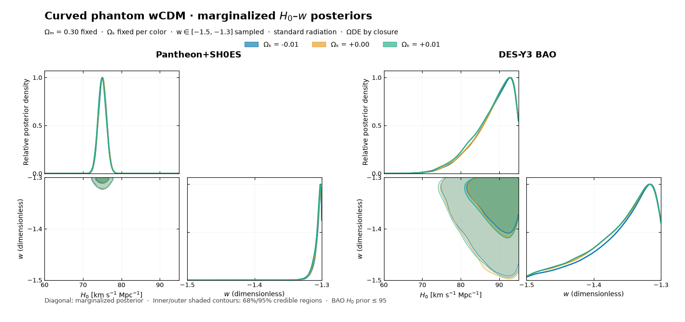

# CosmoSIS-native posterior figures

## Corner comparison

The [H0–w corner figure](corner/h0_w_corner.png) uses the same two-panel corner layout as the reference image: Pantheon+SH0ES on the left and DES-Y3 BAO on the right, with Ωk = −0.01, 0, +0.01 in blue, orange, and green. The lower panels show approximate 68% and 95% joint credible contours. The chains are thinned by ten after the 30% burn cut for this KDE figure.

Only H0 and w are continuous sampled parameters here. Ωk has three *fixed* values and is shown by color; Ωm = 0.30 is fixed for every run. Smooth Ωk or Ωm contour axes would imply a sampling procedure that was not performed.

## Individual posteriors

These figures were made from the six saved CosmoSIS `emcee` chains with the installed `cosmosis-postprocess` command. The first 30% of each chain was discarded. Solid curves are CosmoSIS-smoothed marginalized sample densities, each scaled to a peak height of one; they are not relative model probabilities. In the fixed-curvature H0 plots, dashed curves and dotted vertical markers show Gaussian summaries calculated from the same post-burn samples. The CosmoSIS tweak hook adds labels and summaries to the native plots.

All runs use fixed Ωm = 0.30 and standard radiation (Tcmb = 2.7255 K, Neff = 3.046). The constant phantom w is sampled over [−1.5, −1.3], and ΩDE follows density closure. The BAO result is conditional on the CAMB sound-horizon calibration. The H0 axis is labelled in km/s/Mpc; the w axis is dimensionless. The vertical axis is relative posterior density, with each curve scaled to a peak of one.

| Comparison | H0 posterior | w posterior | Cosmological settings |
|---|---|---|---|
| Ωk = −0.01: Pantheon+SH0ES versus DES-Y3 BAO | [PNG](omega_k_minus_0p01/h0.png) | [PNG](omega_k_minus_0p01/w.png) | Ωm = 0.30; w ∈ [−1.5, −1.3] |
| Ωk = 0: Pantheon+SH0ES versus DES-Y3 BAO | [PNG](omega_k_zero/h0.png) | [PNG](omega_k_zero/w.png) | Ωm = 0.30; w ∈ [−1.5, −1.3] |
| Ωk = +0.01: Pantheon+SH0ES versus DES-Y3 BAO | [PNG](omega_k_plus_0p01/h0.png) | [PNG](omega_k_plus_0p01/w.png) | Ωm = 0.30; w ∈ [−1.5, −1.3] |
| Pantheon+SH0ES across Ωk | [PNG](pantheon_curvature/h0.png) | [PNG](pantheon_curvature/w.png) | Ωm = 0.30; w ∈ [−1.5, −1.3] |
| DES-Y3 BAO across Ωk | [PNG](bao_curvature/h0.png) | [PNG](bao_curvature/w.png) | Ωm = 0.30; w ∈ [−1.5, −1.3] |

The DES-Y3 BAO H0 posterior climbs to the sampled upper prior bound, H0 = 95 km/s/Mpc. The Gaussian mean and 1σ in the [report](../curved_wcdm_report.md) are therefore descriptive summaries, not the location and width of the sampled posterior's peak.

Regenerate all figures from the study root with `sh scripts/create_native_figures.sh`, or regenerate just the corner figure with `sh scripts/create_native_figures.sh --corner-only`. The script keeps only the presentation figures; CosmoSIS's temporary trace plots and extra tables are discarded.
