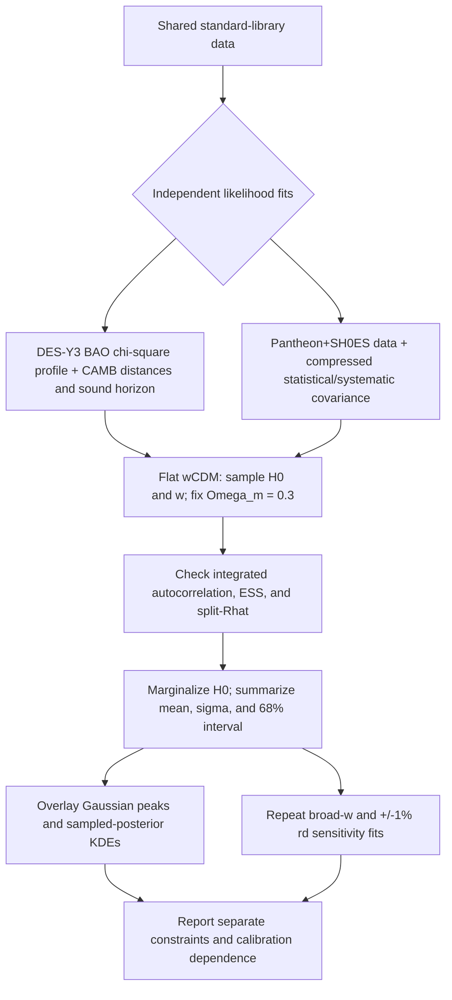

# DES-Y3 BAO and Pantheon+SH0ES: Hubble-constant comparison

Both likelihoods are fit independently in flat constant-\(w\) CDM with \Omega_m=0.3 fixed. The sampled parameters are \(H_0\) and \(w\); Pantheon+SH0ES also samples its absolute-magnitude nuisance parameter. DES-Y3 uses the standard early-Universe CAMB sound-horizon calculation with fixed input densities, so its absolute \(H_0\) posterior is conditional on that ruler calibration.

Inputs are read from the shared standard-library DES-Y3 BAO chi-square profile and Pantheon+SH0ES data/covariance; no likelihood data are copied into this project. The CAMB calibration fixes \(\omega_b=0.048\), \(A_s=2.19\times10^{-9}\), \(n_s=0.97\), \(N_{eff}=3.046\), and the standard photon temperature.

The figure overlays Gaussian summaries of the marginalized posteriors. Each dashed marker is the Gaussian peak (the posterior sample mean); dotted curves show KDE estimates from the actual samples. The Gaussian is an approximation, assessed with skewness and KDE-to-Gaussian distance.

## Main physical-prior results

| Dataset | Gaussian peak H₀ | 68% posterior interval | Gaussian σ | Skewness | KDE/Gaussian L1 | Samples |
|---|---:|---:|---:|---:|---:|---:|
| Pantheon+SH0ES | 73.45 | 72.45–74.45 (median 73.44) | 1.01 | 0.059 | 0.020 | 157,472 |
| DES-Y3 BAO | 72.56 | 58.76–86.68 (median 72.23) | 12.14 | 0.042 | 0.234 | 168,000 |

## Assumptions and interpretation

- Main prior: \( -1 \leq w < -1/3 \). A separate sensitivity run uses \( -1.5 \leq w < -1/3 \); its phantom part is phenomenological and is not treated as a canonical scalar-field model. The sampled \(H_0\) prior is 50–95 km s⁻¹ Mpc⁻¹.
- DES-Y3 BAO constrains a distance-to-sound-horizon ratio. The quoted BAO \(H_0\) result is conditional on the fixed standard early-Universe inputs used to calculate \(r_d\). It is not an independent, ruler-free absolute measurement.
- Pantheon+SH0ES includes the SH0ES Cepheid calibration; the fitted constraint is not an independent replication of SH0ES.
- These are separate posteriors, not a combined estimate. The fixed \(\Omega_m\) choice and the \(w\) prior affect their widths and locations.

## Workflow tree

## Sampling checks

- Pantheon+SH0ES: converged with 7,029 steps/walker; steps/\(\tau\) = 180.2, 183.1, 179.9; split-Rhat = 1.0080, 1.0076, 1.0080; ESS = 4037, 4102, 4030.
- DES-Y3 BAO: converged with 7,500 steps/walker; steps/\(\tau\) = 173.8, 192.1; split-Rhat = 1.0075, 1.0094; ESS = 3892, 4304.

## Gaussian approximation and sensitivity

The DES-Y3 BAO posterior is much broader than Pantheon+SH0ES and its KDE/Gaussian L1 distance is comparatively large, so its Gaussian curve is a visual summary rather than a complete description. Use the separate 68% interval and dotted KDE when reading its uncertainty. Flat-model broad-\(w\) and ±1% \(r_d\) sensitivity results are in `../sensitivity/README.md`; the phantom-inclusive prior is phenomenological, and the ruler shifts quantify the BAO calibration dependence.
