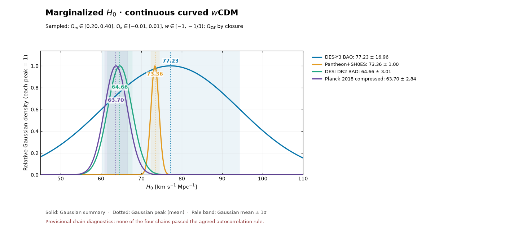

# The Hubble constant across four cosmological probes

## About the project

The Hubble constant, \(H_0\), describes the Universe's present expansion rate. This study asks how its inferred value changes when the same curved, constant-\(w\) cosmological model is fitted separately to DES-Y3 BAO, DESI DR2 BAO, Pantheon+SH0ES, and a compressed approximation to Planck 2018 CMB information. The aim is to see which datasets localize \(H_0\), how their distributions differ, and which assumptions shape that comparison. The likelihoods are **not combined** into one result.

## The problem

BAO, calibrated supernovae, and CMB information constrain expansion in different ways. BAO measures distances relative to the sound horizon \(r_d\), so an absolute \(H_0\) inference depends on an early-Universe calibration. Pantheon+SH0ES includes an absolute distance calibration, while Planck infers late-time expansion from early-Universe information within a model. Comparing their Gaussian summaries without accounting for these differences can make a broad or asymmetric posterior look more decisive than it is.

## Approach

Each dataset has its own CosmoSIS pipeline. All four continuously sample \(H_0\) from 45 to 110 km s⁻¹ Mpc⁻¹, matter density \(\Omega_m\) from 0.20 to 0.40, curvature density \(\Omega_k\) from −0.01 to +0.01, and constant dark-energy equation of state \(w\) from −1 to just below −1/3. Radiation follows fixed standard photon and neutrino settings. Dark-energy density is derived from \(\Omega_r+\Omega_m+\Omega_k+\Omega_{\rm DE}=1\), rather than fixed independently. Some allowed combinations near \(w=-1/3\) do not accelerate today; that is tracked in the analysis.

DES-Y3 contributes a transverse BAO distance at effective redshift 0.835. DESI DR2 contributes BAO distances across seven redshift bins. Both use CAMB's calculated sound horizon under stated early-Universe inputs, including fixed \(\Omega_b=0.048\); neither includes a BBN observational likelihood. Pantheon+SH0ES also samples the supernova magnitude nuisance parameter. The Planck comparison samples \(\Omega_b\) and uses a deliberately simplified likelihood for the acoustic scale and physical matter densities. It is **not** the full Planck power-spectrum analysis.

The saved chains were marginalized over the other sampled parameters to obtain an \(H_0\) distribution for each dataset. A Gaussian was then fitted descriptively with its center at the chain mean and its width at one sample standard deviation. Histograms show the actual sampled shapes, including departures from a Gaussian. A vertical line marks each Gaussian center.

## What the current runs show

| Independent dataset | Descriptive Gaussian center ± 1σ for \(H_0\) (km s⁻¹ Mpc⁻¹) | Mean sampled \(w\) | Shape and interpretation |
|---|---:|---:|---|
| DES-Y3 BAO | 77.23 ± 16.96 | −0.727 | Very broad; one BAO distance leaves strong parameter degeneracy. The sample's smoothed mode is about 65.67, far from the Gaussian center. |
| Pantheon+SH0ES | 73.36 ± 1.00 | −0.877 | Narrow, largely because SH0ES supplies the absolute distance calibration. |
| DESI DR2 BAO | 64.66 ± 3.01 | −0.911 | More localized than DES-Y3 because it spans several redshifts; the distribution is asymmetric. |
| Planck 2018 compressed | 63.70 ± 2.84 | −0.851 | Similar width to DESI in this setup, but based on an approximate compressed likelihood. |

**These numbers are provisional diagnostics, not reported measurements.** None of the four chains passed the agreed autocorrelation convergence rule within the maximum of three checks per dataset. Their centers and widths could change with better exploration of parameter space, so this study does not yet quantify a statistically reliable \(H_0\) discrepancy.

The Gaussian figure uses a common \(H_0\) axis. The [four histograms on a 50–80 km s⁻¹ Mpc⁻¹ axis](output/continuous/figures/continuous_h0_histograms_50_80.png) show the sampled distributions on a shared scale; only 55% of DES-Y3's broad chain falls in that window. The [full-range histograms](output/continuous/figures/continuous_h0_histograms.png), [parameter histograms](output/continuous/figures/continuous_parameter_histograms.png), and [joint-parameter plot](output/continuous/figures/continuous_corner.png) show the wider distributions and relationships among \(H_0\), \(\Omega_m\), \(\Omega_k\), and \(w\). Earlier fixed-curvature results are preserved as [PNG figures](output/curved/native_postprocess/corner/h0_w_corner.png).

## What needs improvement

1. Improve chain mixing and establish convergence before treating any Gaussian center or width as a result. The three-check limit has already been reached for these runs.
2. Quantify how BAO's \(H_0\) result shifts under alternative sound-horizon calibrations and reasonable prior boundaries, while preserving the same physics assumptions across comparisons.
3. Replace the compressed Planck approximation with the full likelihood if a direct Planck comparison is required.
4. Assess whether the intended physical model should require acceleration today throughout the prior, and examine how that choice changes the posteriors.

## Final thoughts

The clearest finding so far is methodological: one DES-Y3 BAO distance does not isolate \(H_0\) when \(\Omega_m\), \(\Omega_k\), and \(w\) are free, while several DESI BAO redshifts localize it more strongly under the chosen sound-horizon model. Pantheon+SH0ES and the compressed Planck pipeline appear to favor different regions of \(H_0\), but the present chains are not converged and the Planck likelihood is approximate. The project therefore illustrates how the ruler calibration, dataset coverage, and model freedom affect \(H_0\) inference; it does not yet establish a resolution of the Hubble tension.
